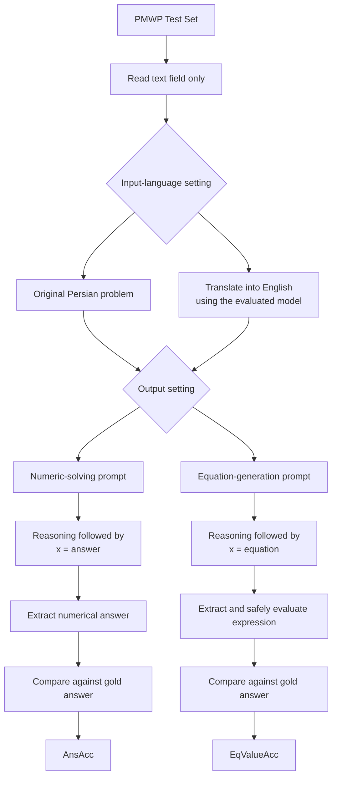

<div align="center">

# Baseline

### Persian Math Word Problem Solving · Inference-Only Evaluation

**The PMWP zero-shot pipeline is the baseline for our study.**

[](https://aclanthology.org/2026.silkroadnlp-1.8/)
[](https://github.com/marzieh-abdolmaleki/PMWP)
[](https://huggingface.co/datasets/marzieh-maleki/PMWP)

*Baseline specification for Persian-Math-SLM-*

</div>

---

## Scope and implementation status

Our baseline follows the **zero-shot evaluation pipeline in Section 4.1** of *PMWP: A Benchmark for Math Word Problem Solving in Persian*. This README maps its published components individually: input fields, language settings, output settings, prompt templates, decoding configuration, and evaluation metrics.

**Status: inference and evaluation code implemented and tested offline in [baseline/](baseline/README.md); live API execution and reproduced scores remain pending.** This specification is derived component by component from the base paper. Unpublished details are explicitly identified below; our implementation choices are documented separately. No exact runtime reproduction or benchmark scores are claimed.

The scope is inference with existing models. LoRA, fine-tuning, weight updates, and dataset construction are outside this baseline.

## Sources

| Resource | Official source |
| :--- | :--- |
| Base paper | [ACL Anthology — PMWP](https://aclanthology.org/2026.silkroadnlp-1.8/) |
| Authors' repository | [marzieh-abdolmaleki/PMWP](https://github.com/marzieh-abdolmaleki/PMWP) |
| Benchmark | [Hugging Face — marzieh-maleki/PMWP](https://huggingface.co/datasets/marzieh-maleki/PMWP) |
| Local paper | [Main Paper.pdf](Main%20Paper.pdf) |

Primary evidence: **Section 4.1 and Table 6, printed pages 78–79**. Dataset description: Section 3. The official GitHub repository inspected at commit `b30f06f1722790d8e87b31a2db5f8db5c861d001` contains a README and license, without inference scripts or prompt files; it does not resolve the missing execution details.

## Evaluation protocol

The paper evaluates its zero-shot systems on the **PMWP test split**. Our development protocol keeps that split separate from method selection:

| Local file | Records | Actual format | Role in our study |
| :--- | ---: | :--- | :--- |
| [trainset.json](trainset.json) | 12,187 | JSON Lines: one object per line | Optional initial inspection and implementation smoke checks; no model training |
| [validset.json](validset.json) | 1,700 | JSON array | Prompt development, method selection, and debugging |
| [testset.json](testset.json) | 1,701 | JSON array | Final evaluation of the frozen baseline and proposed method |
| **Total** | **15,588** | | |

Counts and formats above were checked directly against the supplied files. The paper states an 80/10/10 split; these files instead contain approximately 78.18/10.91/10.91 percent. Use the explicit file counts when describing this evaluation.

1. Develop the implementation and proposed method on validation data.
2. Freeze prompts, model identifiers, inference parameters, parsing rules, and scoring rules.
3. Evaluate the baseline and proposed method on the same complete test split.
4. Preserve per-example outputs and report aggregate scores with failures included.

This validation-first policy is **our experimental protocol**, not an additional procedure attributed to the base paper. There is no requirement to use the training split after test evaluation. Using worked examples from any split in the prompt would create a few-shot setting and must be reported separately from this zero-shot baseline.

## Input contract

**Only `text` supplies the problem content to the model.** Instructions surround that text; reference annotations are kept out of model context.

| Field | Baseline use |
| :--- | :--- |
| `text` | Original Persian problem statement, including its quantities and target variable `x` |
| `id` | Tracking predictions and joining them to references; not a model input |
| `answer` | Gold numerical answer for scoring; never included in the prompt |
| `equation` | Reference equation retained for inspection; not required for the two value-based zero-shot metrics |
| `mapped_text` | Not used in the published baseline |
| `template` | Not used; exposes the reference solution structure |
| `pure_template` | Not used |
| `number_list` | Not supplied as a separate model input |
| `number_position` | Not supplied as a separate model input |

The dataset does not provide worked reasoning traces as a training or prompting field. The baseline requests reasoning from the evaluated model itself.

## Pipeline

The paper crosses **two input-language settings** with **two output settings**, producing four configurations per model.



| Configuration | Problem presented for solving | Required final line | Metric |
| :--- | :--- | :--- | :--- |
| Persian → Numeric | Original Persian `text` | `x = answer` | AnsAcc |
| Persian → Equation | Original Persian `text` | `x = equation` | EqValueAcc |
| English → Numeric | English translation produced by the evaluated model | `x = answer` | AnsAcc |
| English → Equation | English translation produced by the evaluated model | `x = equation` | EqValueAcc |

In the English setting, the same model first translates the Persian problem and then solves it under an English instruction. This measures the end-to-end translation-and-solving workflow; it does not isolate translation quality or the effect of language alone. The paper does not fully specify translation-call orchestration or conversation reuse.

## Published prompt templates

> **Provenance:** The following templates are published in Section 4.1 as English translations of the prompts. PDF line wrapping has been normalized. They document the published wording; they do not establish the exact original Persian API messages or complete request payloads. `<problem text>` denotes insertion of the selected problem text inside angle brackets.

### Numeric answer prediction

```text
You are given a math word problem involving the variable x, enclosed in < >.

Instructions:
• Explain the reasoning steps clearly and completely.
• All explanations must appear before the final line.
• The output must end with exactly one final line.
• The final line must contain only the final numerical answer in the following format:
x = answer
• Do not add any text, symbols, whitespace, or punctuation after the final line.

Problem: <problem text>
Answer:
```

### Symbolic equation generation

```text
You are given a math word problem involving the variable x, enclosed in < >.

Instructions:
• Explain the reasoning steps clearly and completely.
• All explanations must appear before the final line.
• The output must end with exactly one final line.
• The final line must contain only the equation solution in the following format:
x = equation
• Do not numerically simplify the final equation (e.g., keep x = 10/2, not x = 5).
• Do not add any text, symbols, whitespace, or punctuation after the final line.

Problem: <problem text>
Equation:
```

Zero-shot means **no worked in-context examples and no task-specific fine-tuning**. It does not mean answer-only prompting: both published templates request reasoning before the final line. The equation setting asks the model to preserve the arithmetic expression rather than simplify it to a number.

### Prompt details not reported

| Missing item | What the paper provides | Reproduction consequence |
| :--- | :--- | :--- |
| Original Persian numeric prompt | English-translated template above | Exact Persian wording cannot be recovered from the PDF |
| Original Persian equation prompt | English-translated template above | Exact Persian wording cannot be recovered from the PDF |
| Persian-to-English translation prompt | Description of translation by the same model | Translation instructions must be independently specified |
| Exact system prompt | A consistent mathematical-problem-solver role is described | Exact system-message text is unavailable |
| Complete API message structure | General workflow description | Message roles, translation context reuse, and call boundaries are not fully documented |

Any prompts we supply to fill these gaps must be labeled **our implementation choices**, versioned, and published. They must not be presented as verbatim author-provided prompts.

## Models and inference parameters

The paper's zero-shot models are **DeepSeek-V3**, **Gemini-2.5-Flash**, and **GPT-4o**, accessed through their respective APIs.

| Parameter or behavior | Paper-reported setting |
| :--- | :--- |
| Temperature | `0` |
| Decoding | Described as greedy decoding |
| Task-specific fine-tuning | None |
| Worked in-context examples | None |
| Reasoning requested | Yes, before the final answer/equation line |
| Cross-model configuration | Described as identical decoding configurations; complete payloads are not published |
| System role | Mathematical problem solver; exact wording not reported |

The paper does **not report** exact model snapshots/API versions, output-token limits, `top_p`, `top_k`, random seeds, stop sequences, reasoning/thinking budgets, retry policies, or repeated-run counts. Do not infer values for those settings or assume every provider supports the same parameters. Our eventual implementation must record supported explicit settings, provider defaults relied upon, and run dates. Temperature zero alone does not guarantee identical responses across providers or runs.

## Evaluation metrics

The baseline uses the **two zero-shot metrics from Section 4.1**, evaluated separately for Persian and English inputs.

### Answer accuracy — AnsAcc

The percentage of test problems for which the extracted numerical prediction equals the gold `answer`:

```text
AnsAcc (%) = 100 × number of correct numerical predictions / number of test problems
```

### Value-based equation accuracy — EqValueAcc

The percentage of test problems for which solving/evaluating the generated equation yields the gold `answer`:

```text
EqValueAcc (%) = 100 × number of generated equations yielding the gold answer / number of test problems
```

For the expected `x = expression` output, compute the right-hand-side value and compare it with the reference answer. This metric does not require a textual match with the gold `equation`.

| Gold answer | Generated final line | Value-based result |
| ---: | :--- | :--- |
| 80 | `x = 10 * 8` | Correct |
| 80 | `x = 8 * 10` | Correct |
| 80 | `x = 10 + 8` | Incorrect |

EqValueAcc checks the resulting value, not a proof that the expression faithfully represents the problem in every possible case. Compliance with the unsimplified-expression instruction is also distinct from numerical correctness.

**Scoring details not reported:** exact final-line extraction, numerical normalization, floating-point tolerance, expression-parser behavior, and handling of malformed, missing, truncated, or failed responses. These must be specified before evaluation. Our planned policy is to keep the full test-set denominator and count invalid or missing predictions as incorrect, while separately reporting failure counts. This is a declared implementation policy, not a recovered detail of the authors' evaluator. Generated expressions must be evaluated with a restricted arithmetic parser, never unrestricted code execution.

`EqMatchAcc`, `EqMismatch`, and the training-table `Errors` metric are outside this baseline; they belong to the paper's fine-tuning experiments.

## Published reference results

**Source: Table 6 of the base paper. These are the authors' reported scores, not results reproduced by this repository.** All values are percentages.

| Model | AnsAcc · Persian | AnsAcc · English | EqValueAcc · Persian | EqValueAcc · English |
| :--- | ---: | ---: | ---: | ---: |
| DeepSeek-V3 | **71.66** | 71.31 | 70.49 | 69.43 |
| Gemini-2.5-Flash | 69.66 | **73.60** | **72.02** | **71.43** |
| GPT-4o | 53.26 | 71.31 | 66.49 | 67.78 |

English translation does not improve every model or metric. In particular, DeepSeek-V3 decreases slightly in both columns after translation. Future results from our implementation must be presented separately, with their model versions, prompts, settings, dataset revision, and scoring rules.

## Component-by-component fidelity

| Component | Relationship to the base paper | Current repository status |
| :--- | :--- | :--- |
| Test-set inference | Section 4.1 | Implemented; live evaluation pending |
| Problem content from `text` | Persian problem statement described in Section 4.1 | Input contract documented |
| Persian and translated-English paths | Section 4.1 | Implemented; tested offline |
| Numeric and equation output modes | Section 4.1 | Implemented; tested offline |
| Published solving templates | Prompt boxes on page 78 | Transcribed above |
| Temperature zero / reported greedy decoding | Page 79 | Implemented; live API behavior not verified |
| AnsAcc and EqValueAcc | Section 4.1 and Table 6 | Implemented; tested offline |
| Original-language/system/translation prompts | Not fully published | Explicit reproduction gaps |
| Validation-first development policy | Our study protocol | Documented separately from paper claims |

This mapping makes the baseline traceable to the base paper without claiming unpublished author details or completed live experiments. See the [implementation guide](baseline/README.md) for commands, tests, and local scoring policies.

## Citation

Please cite PMWP when using the benchmark or its baseline protocol:

```bibtex
@inproceedings{abdolmaleki-etal-2026-pmwp,
  title = "{PMWP}: A Benchmark for Math Word Problem Solving in {Persian}",
  author = "Abdolmaleki, Marzieh and Shamsfard, Mehrnoush and Hoste, Veronique and Lefever, Els",
  booktitle = "The Proceedings of the First Workshop on NLP and LLMs for the Iranian Language Family",
  month = mar,
  year = "2026",
  address = "Rabat, Morocco",
  publisher = "Association for Computational Linguistics",
  pages = "74--82",
  doi = "10.18653/v1/2026.silkroadnlp-1.8",
  url = "https://aclanthology.org/2026.silkroadnlp-1.8/"
}
```

---

## Implemented Baseline

The inference-only baseline described above is now implemented in [`baseline/`](baseline/). It follows the **published zero-shot workflow in Section 4.1 of the original PMWP paper**, with explicit local choices wherever the authors do not provide enough detail for exact reproduction. Implementation and offline validation are complete; live OpenRouter runs and reproduced benchmark scores remain pending.

### Repository organization

Code, configuration, prompts, tests, and experimental outputs have separate locations:

```text
Persian-Math-SLM-/
├── README.md                         # Paper-derived baseline specification and implementation overview
├── Main Paper.pdf
├── trainset.json                     # Original benchmark files, kept unchanged
├── validset.json
├── testset.json
├── .github/workflows/baseline.yml     # Automated quality checks
└── baseline/
    ├── README.md                     # Installation, CLI usage, scoring policies, and limitations
    ├── pyproject.toml                # Package metadata and development tools
    ├── uv.lock                       # Locked dependencies
    ├── configs/
    │   └── example.json              # Model/provider and inference configuration template
    ├── src/pmwp_baseline/
    │   ├── config.py                 # Configuration validation
    │   ├── data.py                   # JSON/JSONL loading and dataset validation
    │   ├── prompts.py                # Shared prompt rendering and prompt hashes
    │   ├── prompts/                  # Versioned solving, translation, and system prompts
    │   ├── client.py                 # OpenRouter HTTPS transport and bounded retries
    │   ├── runner.py                 # Pipeline orchestration, persistence, and resume
    │   ├── parsing.py                # Final-line extraction and restricted arithmetic evaluation
    │   ├── evaluation.py             # AnsAcc, EqValueAcc, and diagnostic summaries
    │   ├── telemetry.py              # Token, cost, and latency summaries
    │   └── cli.py                    # Validation, inference, re-scoring, and comparison commands
    ├── tests/
    │   ├── unit/                     # Component behavior and failure cases
    │   ├── integration/              # Offline pipeline and CLI integration
    │   └── fixtures/                 # Small synthetic test inputs
    └── results/
        ├── README.md                 # Artifact definitions and publication policy
        └── <run-id>/                 # One directory per experiment; generated when run
            ├── manifest.json
            ├── predictions.jsonl
            ├── summary.json
            ├── failures.jsonl
            └── reevaluated-summary.json  # Optional offline re-scoring output
```

Generated run directories are ignored by Git by default. Selected, reviewed results can be explicitly committed for publication. The result filenames above describe what an execution produces; they do not indicate that real model results already exist.

### What was implemented

All inference goes through **OpenRouter**. Each run selects one explicit model, provider, input-language setting, and output mode. Provider fallback is disabled, and unsupported requested parameters must not be silently ignored. The same prompt templates and configured settings are used across models.

The pipeline reads only the problem's `text` into model context. Persian configurations solve that original text directly. English configurations first translate it using the same configured model/provider, then issue a separate solving request. Numeric mode extracts `x = answer`; equation mode extracts `x = expression` and computes its value using a bounded arithmetic parser. Gold answers and reference equations are never included in requests.

Predictions are written incrementally, with a flush and filesystem sync after each problem. A manifest records dataset fingerprints, selected IDs, complete configuration, prompt texts and hashes, source hashes, and the Git revision. Resume requires matching inputs and settings and skips already recorded examples, including terminal failures. Separate run-directory locking prevents concurrent writers from mixing results.

### How prompts were handled

| Prompt files | Origin and treatment |
| :--- | :--- |
| `numeric.en.txt`, `equation.en.txt` | Published English-translated templates from the paper, with PDF line wrapping normalized and the problem placeholder rendered at runtime |
| `numeric.fa.txt`, `equation.fa.txt` | Our faithful Persian translations of those published templates; the authors' exact original Persian wording is unavailable |
| `translation.txt` | Our translation-only instruction, preserving quantities, units, relationships, and `x`; the original translation prompt was not reported |
| `system.txt` | Our mathematical-problem-solver instruction; the paper describes this role but does not publish its exact wording |

Prompt files live in [`baseline/src/pmwp_baseline/prompts/`](baseline/src/pmwp_baseline/prompts/). Their contents are shared across models and captured in each run manifest. These local translations and missing-prompt replacements are disclosed implementation choices, not verbatim prompts recovered from the authors.

### Alignment with the original paper

| Paper component | Implemented behavior |
| :--- | :--- |
| Zero-shot inference without task-specific training | No weight updates, LoRA, or worked in-context examples |
| Persian problem input | Only `text` supplies problem content |
| Direct Persian and translated-English evaluation | Both paths are implemented; translation uses the evaluated model |
| Numeric answer and symbolic equation generation | Both output modes are implemented, including requests for reasoning before the final line |
| Temperature zero | Configuration enforces `temperature = 0`; exact provider decoding behavior still requires live verification |
| Test-set evaluation | Full-test execution is supported; validation is used separately for our development and smoke checks |
| AnsAcc | Extracted numerical prediction compared with the gold `answer` |
| EqValueAcc | Generated expression's computed value compared with the gold `answer`, without requiring an exact equation-string match |

**The published pipeline and metric definitions follow the base paper; full equivalence with the authors' private execution details is not claimed.** OpenRouter is our API access layer, whereas the paper describes the models' respective APIs. Exact historical model availability, provider defaults, and runtime behavior must be checked before reporting a reproduction.

Output-token limits, numerical tolerances, parsing/normalization rules, timeout/retry behavior, and treatment of malformed responses were not fully reported by the paper. Our chosen policies are documented in the [implementation guide](baseline/README.md). For example, invalid or missing predictions remain in the evaluation denominator, and generated expressions are evaluated without unrestricted code execution. These policies make our runs inspectable without attributing unpublished settings to the original authors.

### Additional analysis and quality checks

The paper's two zero-shot metrics remain the primary scores. Separate diagnostics add token consumption, reported cost, reported cost per correct answer, full-response latency distributions, retry/API failure counts, output validity, formatting compliance, and accuracy by problem structure. English runs include translation and solving costs separately and together. Missing usage remains unknown rather than being treated as zero; time to first token is not measured by the nonstreaming client.

Offline commands can re-score saved responses and compare complete runs on matching examples. Summaries include Wilson accuracy intervals; paired comparisons include a deterministic bootstrap interval for the accuracy difference. These example-based intervals do not measure variability across repeated API runs.

**Local verification completed:** 20 unit/integration tests passed, along with lint, formatting, strict type checks, validation of all three supplied benchmark files, and a wheel installation check that confirmed all six prompt files are packaged. Tests cover parsing safety, request construction, retries, translation/solving flow, scoring, result persistence, interruption/resume, directory locking, and incompatible-run rejection. They use synthetic responses and make no paid requests.

GitHub Actions is configured for Python 3.11–3.13; the local results above do not establish remote CI execution. The next experimental step is a small validation smoke run after securely configuring `OPENROUTER_API_KEY` and selecting available model/provider identifiers. See [`baseline/README.md`](baseline/README.md) for commands.

### Current development stage and benchmark correction

We currently use **`validset.json`** for pipeline testing, prompt development, and validation of data transfer, response parsing, scoring, and result persistence. Here, testing means development and verification of the implementation; it is not the final benchmark evaluation. The training split is not required for this inference-only study.

Our **final evaluation split is `testset.json`**, matching the original paper's zero-shot test-set evaluation in Section 4.1 and Table 6. Prompts and inference/scoring settings must be frozen before final model comparison.

We have identified inconsistencies in the supplied test split. A planned phase of this study is to audit and classify test-set issues, review the original paper's quality assessment, and produce documented corrections before using a corrected benchmark for final evaluation. This phase is not complete. Original benchmark files and split membership will be preserved, and any corrected version and its results will be distinguished from the original version. Benchmark correction is separate from establishing that the pipeline itself works correctly.

Infrastructure-only retry and a separate recovery pass are implemented; incorrect answers, invalid output formats, `missing_content`, and `invalid_response` are not resubmitted. New diagnostic metrics and error-attribution methods remain subject to protocol review before implementation.


### Timing and token accounting

New runs use telemetry schema 2: individual OpenRouter attempts retain response timing, local JSON-processing timing, actual retry waits, and provider-reported usage. Summaries separate successful API responses from failures independently of mathematical correctness, and separate translation from solving. Initial problem processing, recovery processing, and cumulative work have distinct definitions; cumulative recovery work is not labeled end-to-end elapsed latency.

Input/output/total tokens, cost, and available reasoning/cache details carry explicit coverage counts. Reasoning and cache counts are subsets, not additions to total tokens. Missing reasoning information does not establish whether a model supports or uses reasoning; the current policy remains provider-default and is recorded. Full definitions and legacy-artifact limitations are in [baseline/METRICS.md](baseline/METRICS.md). Baseline execution and scoring do not invoke an LLM judge; downstream review is separate.
