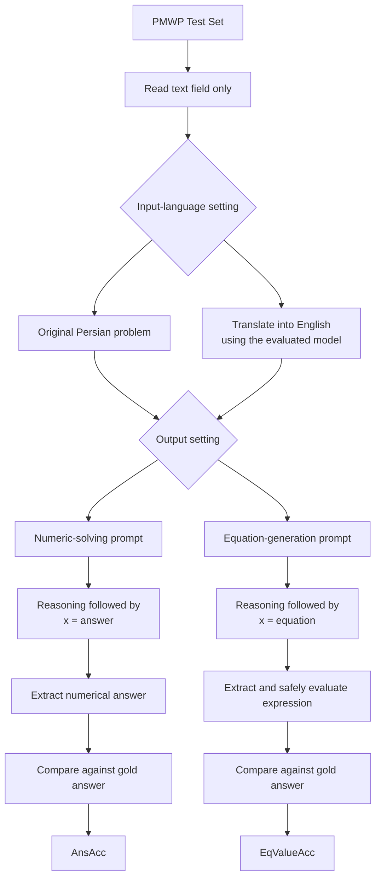

<div align="center">

# Baseline

### Persian Math Word Problem Solving · Inference-Only Evaluation

**The PMWP zero-shot pipeline is the baseline for our study.**

[](https://aclanthology.org/2026.silkroadnlp-1.8/)
[](https://github.com/marzieh-abdolmaleki/PMWP)
[](https://huggingface.co/datasets/marzieh-maleki/PMWP)

*Baseline specification for Persian-Math-SLM-*

</div>

---

## Scope and implementation status

Our baseline follows the **zero-shot evaluation pipeline in Section 4.1** of *PMWP: A Benchmark for Math Word Problem Solving in Persian*. This README maps its published components individually: input fields, language settings, output settings, prompt templates, decoding configuration, and evaluation metrics.

**Status: baseline documented; executable inference and evaluation code has not yet been implemented in this repository.** No model runs or reproduced scores are claimed here. This is a component-by-component specification derived from the base paper, not a claim of completed or exact runtime reproduction. Unpublished details are explicitly identified below and must be resolved and recorded before implementation can be considered reproducible.

The scope is inference with existing models. LoRA, fine-tuning, weight updates, and dataset construction are outside this baseline.

## Sources

| Resource | Official source |
| :--- | :--- |
| Base paper | [ACL Anthology — PMWP](https://aclanthology.org/2026.silkroadnlp-1.8/) |
| Authors' repository | [marzieh-abdolmaleki/PMWP](https://github.com/marzieh-abdolmaleki/PMWP) |
| Benchmark | [Hugging Face — marzieh-maleki/PMWP](https://huggingface.co/datasets/marzieh-maleki/PMWP) |
| Local paper | [Main Paper.pdf](Main%20Paper.pdf) |

Primary evidence: **Section 4.1 and Table 6, printed pages 78–79**. Dataset description: Section 3. The official GitHub repository inspected at commit `b30f06f1722790d8e87b31a2db5f8db5c861d001` contains a README and license, without inference scripts or prompt files; it does not resolve the missing execution details.

## Evaluation protocol

The paper evaluates its zero-shot systems on the **PMWP test split**. Our development protocol keeps that split separate from method selection:

| Local file | Records | Actual format | Role in our study |
| :--- | ---: | :--- | :--- |
| [trainset.json](trainset.json) | 12,187 | JSON Lines: one object per line | Optional initial inspection and implementation smoke checks; no model training |
| [validset.json](validset.json) | 1,700 | JSON array | Prompt development, method selection, and debugging |
| [testset.json](testset.json) | 1,701 | JSON array | Final evaluation of the frozen baseline and proposed method |
| **Total** | **15,588** | | |

Counts and formats above were checked directly against the supplied files. The paper states an 80/10/10 split; these files instead contain approximately 78.18/10.91/10.91 percent. Use the explicit file counts when describing this evaluation.

1. Develop the implementation and proposed method on validation data.
2. Freeze prompts, model identifiers, inference parameters, parsing rules, and scoring rules.
3. Evaluate the baseline and proposed method on the same complete test split.
4. Preserve per-example outputs and report aggregate scores with failures included.

This validation-first policy is **our experimental protocol**, not an additional procedure attributed to the base paper. There is no requirement to use the training split after test evaluation. Using worked examples from any split in the prompt would create a few-shot setting and must be reported separately from this zero-shot baseline.

## Input contract

**Only `text` supplies the problem content to the model.** Instructions surround that text; reference annotations are kept out of model context.

| Field | Baseline use |
| :--- | :--- |
| `text` | Original Persian problem statement, including its quantities and target variable `x` |
| `id` | Tracking predictions and joining them to references; not a model input |
| `answer` | Gold numerical answer for scoring; never included in the prompt |
| `equation` | Reference equation retained for inspection; not required for the two value-based zero-shot metrics |
| `mapped_text` | Not used in the published baseline |
| `template` | Not used; exposes the reference solution structure |
| `pure_template` | Not used |
| `number_list` | Not supplied as a separate model input |
| `number_position` | Not supplied as a separate model input |

The dataset does not provide worked reasoning traces as a training or prompting field. The baseline requests reasoning from the evaluated model itself.

## Pipeline

The paper crosses **two input-language settings** with **two output settings**, producing four configurations per model.



| Configuration | Problem presented for solving | Required final line | Metric |
| :--- | :--- | :--- | :--- |
| Persian → Numeric | Original Persian `text` | `x = answer` | AnsAcc |
| Persian → Equation | Original Persian `text` | `x = equation` | EqValueAcc |
| English → Numeric | English translation produced by the evaluated model | `x = answer` | AnsAcc |
| English → Equation | English translation produced by the evaluated model | `x = equation` | EqValueAcc |

In the English setting, the same model first translates the Persian problem and then solves it under an English instruction. This measures the end-to-end translation-and-solving workflow; it does not isolate translation quality or the effect of language alone. The paper does not fully specify translation-call orchestration or conversation reuse.

## Published prompt templates

> **Provenance:** The following templates are published in Section 4.1 as English translations of the prompts. PDF line wrapping has been normalized. They document the published wording; they do not establish the exact original Persian API messages or complete request payloads. `<problem text>` denotes insertion of the selected problem text inside angle brackets.

### Numeric answer prediction

```text
You are given a math word problem involving the variable x, enclosed in < >.

Instructions:
• Explain the reasoning steps clearly and completely.
• All explanations must appear before the final line.
• The output must end with exactly one final line.
• The final line must contain only the final numerical answer in the following format:
x = answer
• Do not add any text, symbols, whitespace, or punctuation after the final line.

Problem: <problem text>
Answer:
```

### Symbolic equation generation

```text
You are given a math word problem involving the variable x, enclosed in < >.

Instructions:
• Explain the reasoning steps clearly and completely.
• All explanations must appear before the final line.
• The output must end with exactly one final line.
• The final line must contain only the equation solution in the following format:
x = equation
• Do not numerically simplify the final equation (e.g., keep x = 10/2, not x = 5).
• Do not add any text, symbols, whitespace, or punctuation after the final line.

Problem: <problem text>
Equation:
```

Zero-shot means **no worked in-context examples and no task-specific fine-tuning**. It does not mean answer-only prompting: both published templates request reasoning before the final line. The equation setting asks the model to preserve the arithmetic expression rather than simplify it to a number.

### Prompt details not reported

| Missing item | What the paper provides | Reproduction consequence |
| :--- | :--- | :--- |
| Original Persian numeric prompt | English-translated template above | Exact Persian wording cannot be recovered from the PDF |
| Original Persian equation prompt | English-translated template above | Exact Persian wording cannot be recovered from the PDF |
| Persian-to-English translation prompt | Description of translation by the same model | Translation instructions must be independently specified |
| Exact system prompt | A consistent mathematical-problem-solver role is described | Exact system-message text is unavailable |
| Complete API message structure | General workflow description | Message roles, translation context reuse, and call boundaries are not fully documented |

Any prompts we supply to fill these gaps must be labeled **our implementation choices**, versioned, and published. They must not be presented as verbatim author-provided prompts.

## Models and inference parameters

The paper's zero-shot models are **DeepSeek-V3**, **Gemini-2.5-Flash**, and **GPT-4o**, accessed through their respective APIs.

| Parameter or behavior | Paper-reported setting |
| :--- | :--- |
| Temperature | `0` |
| Decoding | Described as greedy decoding |
| Task-specific fine-tuning | None |
| Worked in-context examples | None |
| Reasoning requested | Yes, before the final answer/equation line |
| Cross-model configuration | Described as identical decoding configurations; complete payloads are not published |
| System role | Mathematical problem solver; exact wording not reported |

The paper does **not report** exact model snapshots/API versions, output-token limits, `top_p`, `top_k`, random seeds, stop sequences, reasoning/thinking budgets, retry policies, or repeated-run counts. Do not infer values for those settings or assume every provider supports the same parameters. Our eventual implementation must record supported explicit settings, provider defaults relied upon, and run dates. Temperature zero alone does not guarantee identical responses across providers or runs.

## Evaluation metrics

The baseline uses the **two zero-shot metrics from Section 4.1**, evaluated separately for Persian and English inputs.

### Answer accuracy — AnsAcc

The percentage of test problems for which the extracted numerical prediction equals the gold `answer`:

```text
AnsAcc (%) = 100 × number of correct numerical predictions / number of test problems
```

### Value-based equation accuracy — EqValueAcc

The percentage of test problems for which solving/evaluating the generated equation yields the gold `answer`:

```text
EqValueAcc (%) = 100 × number of generated equations yielding the gold answer / number of test problems
```

For the expected `x = expression` output, compute the right-hand-side value and compare it with the reference answer. This metric does not require a textual match with the gold `equation`.

| Gold answer | Generated final line | Value-based result |
| ---: | :--- | :--- |
| 80 | `x = 10 * 8` | Correct |
| 80 | `x = 8 * 10` | Correct |
| 80 | `x = 10 + 8` | Incorrect |

EqValueAcc checks the resulting value, not a proof that the expression faithfully represents the problem in every possible case. Compliance with the unsimplified-expression instruction is also distinct from numerical correctness.

**Scoring details not reported:** exact final-line extraction, numerical normalization, floating-point tolerance, expression-parser behavior, and handling of malformed, missing, truncated, or failed responses. These must be specified before evaluation. Our planned policy is to keep the full test-set denominator and count invalid or missing predictions as incorrect, while separately reporting failure counts. This is a declared implementation policy, not a recovered detail of the authors' evaluator. Generated expressions must be evaluated with a restricted arithmetic parser, never unrestricted code execution.

`EqMatchAcc`, `EqMismatch`, and the training-table `Errors` metric are outside this baseline; they belong to the paper's fine-tuning experiments.

## Published reference results

**Source: Table 6 of the base paper. These are the authors' reported scores, not results reproduced by this repository.** All values are percentages.

| Model | AnsAcc · Persian | AnsAcc · English | EqValueAcc · Persian | EqValueAcc · English |
| :--- | ---: | ---: | ---: | ---: |
| DeepSeek-V3 | **71.66** | 71.31 | 70.49 | 69.43 |
| Gemini-2.5-Flash | 69.66 | **73.60** | **72.02** | **71.43** |
| GPT-4o | 53.26 | 71.31 | 66.49 | 67.78 |

English translation does not improve every model or metric. In particular, DeepSeek-V3 decreases slightly in both columns after translation. Future results from our implementation must be presented separately, with their model versions, prompts, settings, dataset revision, and scoring rules.

## Component-by-component fidelity

| Component | Relationship to the base paper | Current repository status |
| :--- | :--- | :--- |
| Test-set inference | Section 4.1 | Specified; not executed |
| Problem content from `text` | Persian problem statement described in Section 4.1 | Input contract documented |
| Persian and translated-English paths | Section 4.1 | Specified; not implemented |
| Numeric and equation output modes | Section 4.1 | Specified; not implemented |
| Published solving templates | Prompt boxes on page 78 | Transcribed above |
| Temperature zero / reported greedy decoding | Page 79 | Documented; API behavior not verified |
| AnsAcc and EqValueAcc | Section 4.1 and Table 6 | Defined; evaluator not implemented |
| Original-language/system/translation prompts | Not fully published | Explicit reproduction gaps |
| Validation-first development policy | Our study protocol | Documented separately from paper claims |

This mapping makes the baseline traceable to the base paper without claiming unpublished details, completed implementation, or experimental results.

## Citation

Please cite PMWP when using the benchmark or its baseline protocol:

```bibtex
@inproceedings{abdolmaleki-etal-2026-pmwp,
  title = "{PMWP}: A Benchmark for Math Word Problem Solving in {Persian}",
  author = "Abdolmaleki, Marzieh and Shamsfard, Mehrnoush and Hoste, Veronique and Lefever, Els",
  booktitle = "The Proceedings of the First Workshop on NLP and LLMs for the Iranian Language Family",
  month = mar,
  year = "2026",
  address = "Rabat, Morocco",
  publisher = "Association for Computational Linguistics",
  pages = "74--82",
  doi = "10.18653/v1/2026.silkroadnlp-1.8",
  url = "https://aclanthology.org/2026.silkroadnlp-1.8/"
}
```
